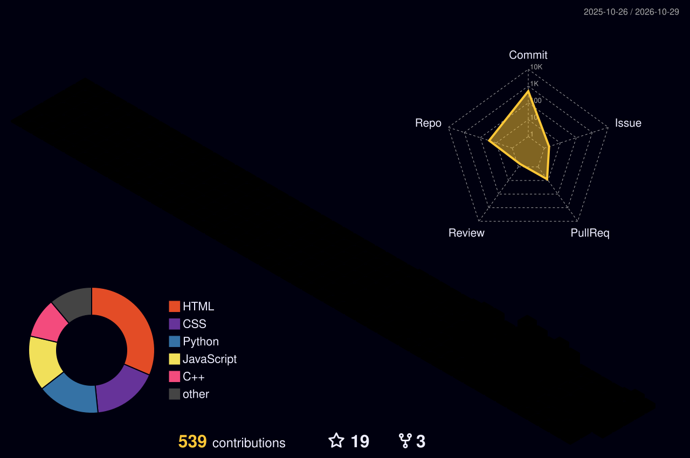
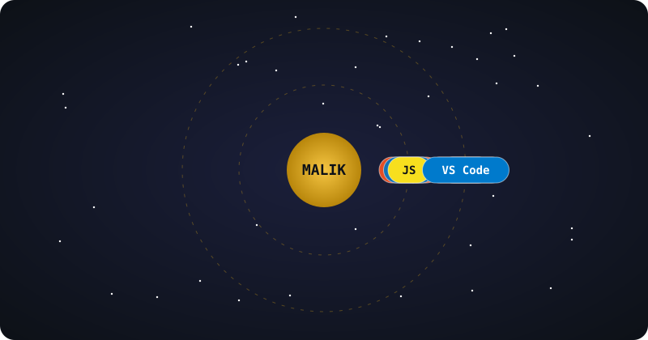
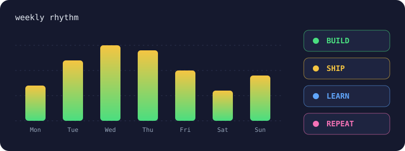
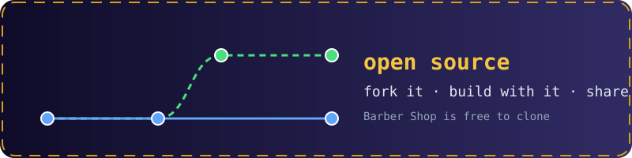

 

---

<picture>
  <source media="(prefers-color-scheme: dark)" srcset="./profile-3d-contrib/profile-night-rainbow.svg">
  <source media="(prefers-color-scheme: light)" srcset="./profile-3d-contrib/profile-season.svg">
  
</picture>

### Tarun — what these towers mean

- **Tall** weeks = heads-down building on new projects
- **Flat** stretches = learning, planning or time away from the keyboard
- **Spiky** weekends = side projects, like [Barber Shop](https://malik25252007.github.io/barber_shop/)

---

  

### why this orbit

HTML, CSS and JavaScript are the core of what I build with. Git, GitHub and VS Code orbit around them: they are how I version, ship and write everything.

### what's at the center this week

> Getting better at front-end fundamentals and building real projects people can actually use.

— [Barber Shop](https://malik25252007.github.io/barber_shop/) · [LinkedIn](https://www.linkedin.com/in/tarun-malik-9bab21388) · [Instagram](https://www.instagram.com/_malik_200716)

---

  

### what these say

- **Commits trend up** because I push small changes often instead of waiting for a big release
- **Streak is steady** because I like building a little every day
- **Cadence skews mid-week** because weekdays are for focus and weekends are for side projects

### live data

  

  

### how I work

- **Peak days are usually mid-week.** I keep deep work away from the start of the week.
- **Long flat stretches** are research and learning weeks, and the code shows up later in one bigger push.
- **Spiky weekends** mean a side project is alive. Currently: [Barber Shop](https://malik25252007.github.io/barber_shop/).

---

  

  <strong>Tarun Malik</strong> · <em>Building clean, responsive websites</em>

  <code>BASE · Greater Noida, UP</code> ·
  <code>STACK · HTML / CSS / JS</code> ·
  <code>STAGE · Leveling up</code>

### currently

Working on and improving my [Barber Shop](https://malik25252007.github.io/barber_shop/) website, a free-to-use site for barbers with services, pricing, branches and a booking form, while sharpening my front-end skills.

---

## Projects

  
<strong>Barber Shop</strong> · <code>html · css · javascript · github-pages</code>

  A responsive website for barbers and salons. It includes services, price list, branch details, a booking form and contact links. Free to clone and use.

  **Stack:** HTML5, CSS3, JavaScript
  **Live:** [malik25252007.github.io/barber_shop](https://malik25252007.github.io/barber_shop/)
  **Repo:** [MALIK25252007/barber_shop](https://github.com/MALIK25252007/barber_shop)

  
<strong>more coming soon</strong> · <em>work in progress</em>

  More projects will be added here as I build them. Follow along on [GitHub](https://github.com/MALIK25252007).

---

  

### how to contribute

Found a bug or have an idea? Open an issue or send a pull request on [barber_shop](https://github.com/MALIK25252007/barber_shop). Small, focused changes are the easiest to review.

### what I maintain

- **[barber_shop](https://github.com/MALIK25252007/barber_shop)** — a free website template for barbers and salons

---

### Let's connect

